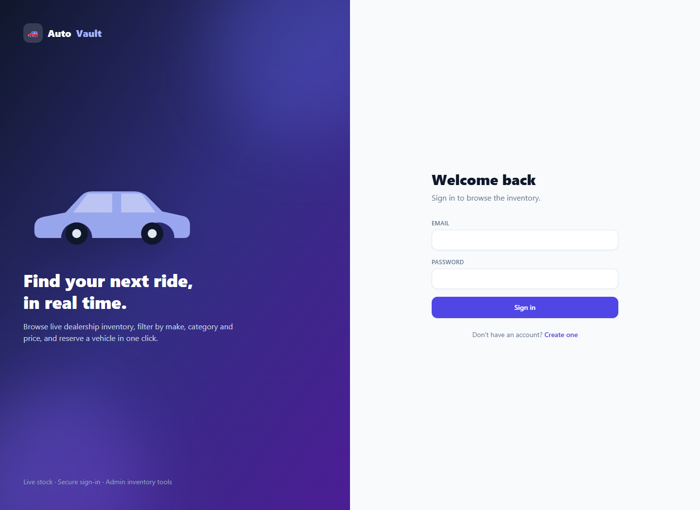
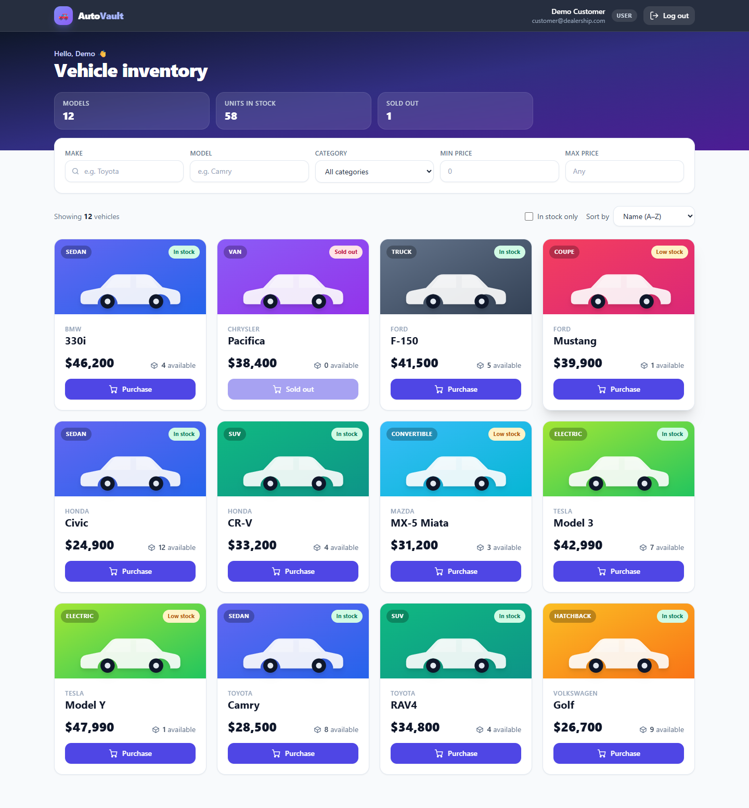
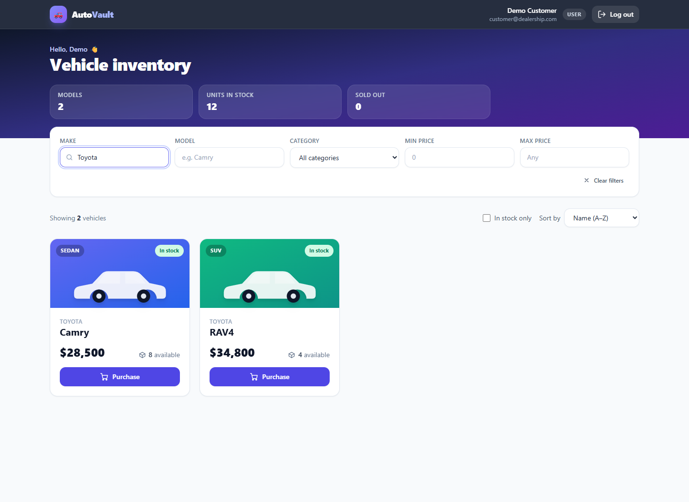
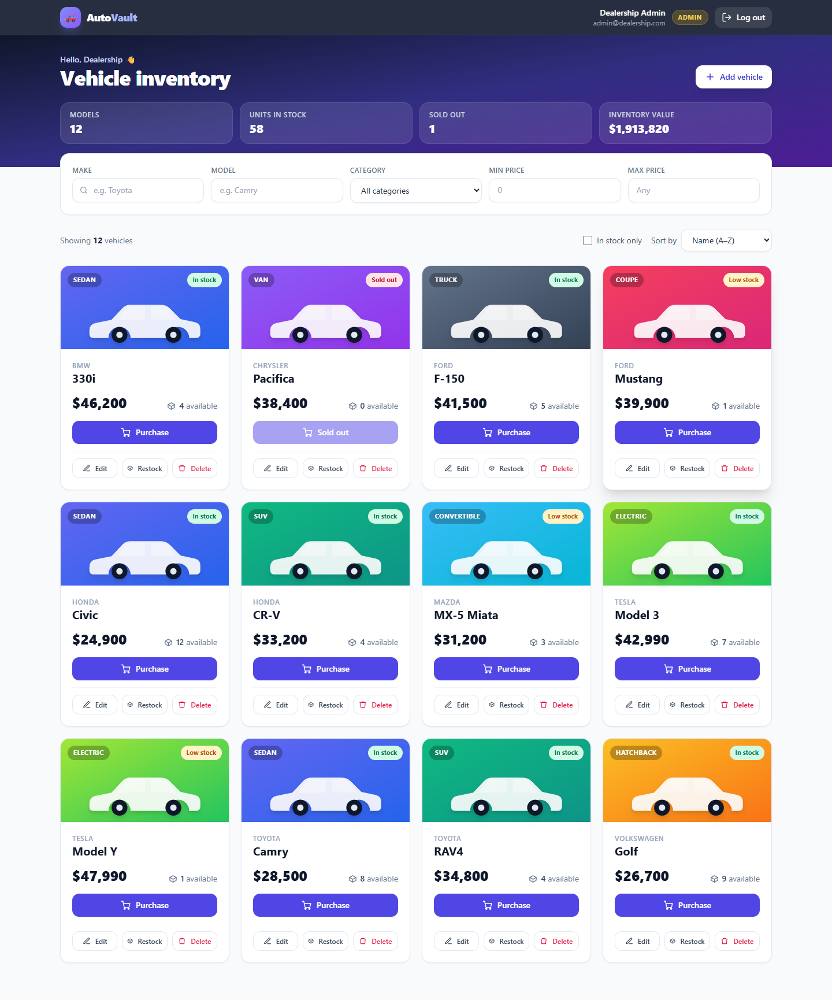

# 🚗 AutoVault – Car Dealership Inventory System

A full-stack inventory platform for a car dealership. Customers register, browse live stock, search/filter and purchase vehicles; administrators add, edit, delete and restock inventory.

> Built for the *TDD Kata: Car Dealership Inventory System*. Backend written test-first (see [Testing & TDD](#testing--tdd)).

**Live demo:** _<add link here if you deploy – optional>_  ·  **Screenshots:** [below](#screenshots)

---

## Table of contents
1. [Features](#features)
2. [Tech stack](#tech-stack)
3. [Architecture](#architecture)
4. [Getting started](#getting-started)
5. [API reference](#api-reference)
6. [Testing & TDD](#testing--tdd)
7. [Test report](#test-report)
8. [Design decisions](#design-decisions)
9. [Screenshots](#screenshots)
10. [My AI Usage](#my-ai-usage)
11. [Deployment (optional)](#deployment-optional)
12. [Possible next steps](#possible-next-steps)

---

## Features

**Everyone (authenticated)**
- Register / log in (JWT); session restored on refresh; automatic logout when a token expires
- Dashboard of all vehicles with live stock badges (*In stock / Low stock / Sold out*)
- Search by make, model, category and price range (debounced, case-insensitive, partial match)
- Sort (name, price, stock) and "in stock only" toggle
- **Purchase** button per vehicle – **disabled when quantity is 0**; stock updates instantly

**Administrators**
- Add / edit / delete vehicles, restock any vehicle
- Inventory-value summary on the dashboard

**Quality**
- Responsive layout (mobile → desktop), skeleton loaders, toasts, accessible modals/forms (labels, `aria-*`, Escape to close)
- Server-side validation (Zod) *and* client-side validation with field-level server errors surfaced in forms

## Tech stack

| Layer | Technology |
|---|---|
| API | Node.js, TypeScript, Express 4 |
| Database | **SQLite (file-backed)** via `better-sqlite3` |
| Auth | JWT (HS256) + bcrypt password hashing, role-based access (`user` / `admin`) |
| Validation | Zod |
| Backend tests | Jest, ts-jest, Supertest |
| Frontend | React 18, TypeScript, Vite, **Tailwind CSS**, React Router, HTML5/CSS3 |
| Frontend tests | Vitest, React Testing Library |

## Architecture

```
backend/src
├── app.ts                 # composition root – wires dependencies together
├── server.ts              # process entry point
├── config.ts              # env-driven configuration
├── db/database.ts         # SQLite connection + schema
├── repositories/          # data access (interfaces + SQLite implementations)
├── services/              # business rules (auth, vehicles, inventory, JWT, hashing)
├── controllers/           # HTTP <-> service translation (thin)
├── middleware/            # authenticate, requireRole, asyncHandler, errorHandler
├── routes/                # route tables
├── validation/schemas.ts  # Zod schemas + parseOrThrow
└── scripts/seed.ts        # admin, demo customer, sample inventory

frontend/src
├── api/client.ts          # typed fetch wrapper, ApiError, token storage
├── context/               # AuthContext, ToastContext
├── components/            # VehicleCard, SearchFilters, modals, Navbar, ...
├── pages/                 # AuthPage (login/register), Dashboard
└── hooks/ utils/
```

**SOLID in practice**
- **S** – controllers parse/translate HTTP, services hold rules, repositories hold SQL.
- **O/L** – services depend on `UserRepository` / `VehicleRepository` interfaces; swap SQLite for Postgres without touching services.
- **I** – small focused interfaces (`PasswordHasher`, `TokenService`, repositories).
- **D** – constructor injection everywhere; `createApp()` is the only place concrete classes are chosen. Unit tests inject in-memory fakes.

## Getting started

### Prerequisites
Node.js ≥ 18 (tested on 20/22) and npm. No external database server is needed.

### 1. Backend
```bash
cd backend
npm install
cp .env.example .env        # then set JWT_SECRET to a long random value
npm run seed                # creates admin + demo customer + 12 sample vehicles
npm run dev                 # http://localhost:4000
```

Seeded accounts:

| Role | Email | Password |
|---|---|---|
| Admin | `admin@dealership.com` | `Admin@12345` |
| Customer | `customer@dealership.com` | `Customer@12345` |

Public registration always creates a **customer**. Admins are provisioned via the seed script, so nobody can escalate their own privileges.

### 2. Frontend
```bash
cd frontend
npm install
npm run dev                 # http://localhost:5173  (proxies /api -> :4000)
```

### Production build
```bash
cd backend  && npm run build && npm start
cd frontend && npm run build        # static files in frontend/dist
```

## API reference

All `/api/vehicles/**` routes require `Authorization: Bearer <token>`. Errors share one shape:
`{ "error": { "code": "VALIDATION_ERROR", "message": "…", "details": [{ "path": "price", "message": "…" }] } }`

| Method | Endpoint | Access | Description | Success |
|---|---|---|---|---|
| POST | `/api/auth/register` | public | `{name, email, password}` → `{user, token}` | 201 |
| POST | `/api/auth/login` | public | `{email, password}` → `{user, token}` | 200 |
| GET | `/api/auth/me` | auth | Current user | 200 |
| GET | `/api/vehicles` | auth | All vehicles (incl. sold-out, so the UI can show them) | 200 |
| GET | `/api/vehicles/search` | auth | Query: `make`, `model`, `category`, `minPrice`, `maxPrice` (all optional, combined with AND) | 200 |
| GET | `/api/vehicles/:id` | auth | One vehicle | 200 |
| POST | `/api/vehicles` | **admin** | `{make, model, category, price, quantity}` | 201 |
| PUT | `/api/vehicles/:id` | **admin** | Partial update | 200 |
| DELETE | `/api/vehicles/:id` | **admin** | Delete | 204 |
| POST | `/api/vehicles/:id/purchase` | auth | Optional `{quantity}` (default 1); decreases stock | 200 |
| POST | `/api/vehicles/:id/restock` | **admin** | `{quantity}` ≥ 1; increases stock | 200 |

Status codes: `400` validation · `401` missing/invalid token or bad credentials · `403` not an admin · `404` not found · `409` duplicate email or insufficient stock.

## Testing & TDD

```bash
cd backend  && npm test                # unit + integration
cd backend  && npm run test:coverage   # with coverage report
cd frontend && npm test
```

**What's covered**
- **Unit:** auth service, JWT service (tampering, expiry, wrong secret, `alg: none`), vehicle & inventory services, Zod schemas.
- **Repository (real SQLite file):** search combinations, LIKE-wildcard escaping, SQL-injection attempt, atomic stock decrement.
- **Integration (Supertest, real app + real DB):** every endpoint – auth required, role enforcement, validation errors, 404/409 paths, and a **concurrency test** proving 8 simultaneous purchases of 3 units sell exactly 3.
- **Frontend:** `VehicleCard` (purchase disabled at 0, admin-only controls), form validation, auth form behaviour, formatting utils.

**Workflow:** each unit of behaviour follows Red → Green → Refactor; the commit order is described in [`COMMIT_PLAN.md`](COMMIT_PLAN.md).

## Test report

> Paste the real output from your machine here before submitting.

```text
$ cd backend && npm run test:coverage
<paste output>

$ cd frontend && npm test
<paste output>
```

## Design decisions

- **Atomic purchases.** Stock is decremented with one `UPDATE … WHERE quantity >= ?` statement, so the check and the write can't interleave – no overselling, no negative stock (also enforced by a `CHECK` constraint).
- **Admin-only writes.** The brief marks delete and restock as admin-only and asks for admin UI to add/update/delete; the API therefore enforces admin for create/update/delete/restock. Purchase and read endpoints are open to any logged-in user.
- **`GET /api/vehicles` returns sold-out vehicles** (rather than hiding them) because the UI must show a disabled *Purchase* button for quantity 0; the "in stock only" toggle filters client-side.
- **No account enumeration:** login returns the same message for unknown email and wrong password.
- **Security basics:** bcrypt hashing, JWT algorithm pinned to HS256, parameterised SQL with a whitelist for dynamic columns, request-size limit, `x-powered-by` disabled, production refuses to start without `JWT_SECRET`.
- **File-backed SQLite** satisfies "not in-memory" with zero setup. The repository interfaces make a PostgreSQL swap straightforward.

## Screenshots

> Add your own screenshots to `docs/screenshots/` and keep these links.

| Login | Dashboard (customer) |
|---|---|
|  |  |

| Search & filters | Admin tools |
|---|---|
|  |  |

## My AI Usage

> ⚠️ **Edit this section so it describes what *you* actually did.** The brief requires an honest account. The text below is a starting draft.

**Tools used:** Claude (Anthropic) via the Claude chat interface. _<add any others: Copilot, ChatGPT, Gemini …>_

**How I used them**
- Gave Claude the kata brief and asked it to generate the initial project: backend architecture (routes → controllers → services → repositories), Zod schemas, JWT/RBAC middleware, SQLite schema, the Jest/Supertest test suites, the React + Tailwind frontend, and this README.
- _<describe what you changed yourself: bugs you fixed, features you added, tests you wrote, refactors>_
- _<describe how you verified the work: ran the suites, manual testing in the browser, code review>_

**Reflection**
- _<what AI did well – e.g. boilerplate, edge-case test ideas, consistent structure>_
- _<where it needed correction or review – e.g. things you caught, assumptions you changed>_
- _<what you learned and what you would do differently>_

Raw chat logs are in [`PROMPTS.md`](PROMPTS.md). Commits that involved AI carry a `Co-authored-by` trailer.

## Deployment (optional)

- **Frontend → Vercel/Netlify:** root `frontend`, build `npm run build`, output `dist`, env `VITE_API_URL=https://<your-api>`. Add an SPA rewrite of all paths to `/index.html`.
- **API → Render/Railway/Fly:** root `backend`, build `npm install && npm run build`, start `npm start`. Set `NODE_ENV=production`, `JWT_SECRET`, `CORS_ORIGIN=<frontend origin>`, and `DB_PATH` pointing at a **persistent volume** (SQLite needs durable disk). Run `npm run seed` once in the shell to create the admin.

## Possible next steps
Pagination, rate-limiting on auth routes, refresh tokens/httpOnly cookies, purchase history & orders table, vehicle images, PostgreSQL + migrations, CI (GitHub Actions running both test suites).
